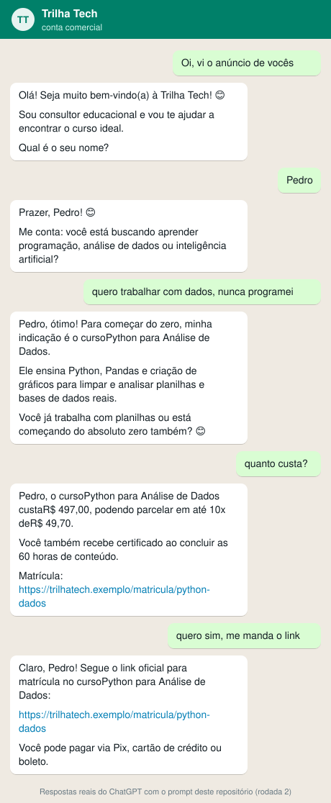

# Agente de vendas no WhatsApp: Trilha Tech

Meu projeto para o Desafio Criativo da DIO **"Projetando o Prompt de um Agente de Atendimento ao Cliente"**, da trilha *Bradesco: Agentes de IA do Zero à Prática*.

## A ideia

Escolhi uma situação que já vivi como cliente: perguntar o preço de um curso pelo WhatsApp e receber uma resposta genérica, ou nenhuma. Criei uma escola fictícia, a **Trilha Tech**, que vende cursos online de programação, dados e IA, e escrevi o prompt do agente que atende esse WhatsApp.

O agente fala com dois públicos. Com quem está pensando em comprar, ele entende o objetivo, indica até dois cursos e manda o link de matrícula. Com quem já é aluno, ele resolve acesso, login e certificado, ou passa a conversa para a equipe quando o assunto não é com ele.

## O bot funcionando

Um contato novo, do primeiro "oi" até o link de matrícula. Rodei o prompt no ChatGPT e montei a conversa no visual do WhatsApp, com as respostas do agente sem nenhuma edição:

<p align="center">
  
</p>

Repare no que o prompt garante: o agente pede o nome antes de seguir, faz uma pergunta por vez, indica o curso usando a ementa do catálogo e só fala de preço e link com os dados do banco. A conversa completa, com o pedido de suporte no final, está em [`testes/kit-rodada-2.md`](testes/kit-rodada-2.md) e no resultado da rodada 2.

## O que eu quis evitar

O maior risco de um chatbot de vendas é inventar: um cupom que não existe, um preço desatualizado, uma promessa de emprego. Por isso o agente não sabe nada sozinho. Em cada conversa, o sistema consulta um banco SQL e entrega três blocos de dados, e o prompt proíbe usar qualquer coisa fora deles.

```
Mensagem no WhatsApp
        │
        ▼
Sistema busca o número na tabela clientes
        │
        ├── Q1 → [DADOS_DO_CLIENTE]  nome, consentimento, interesses, matrículas, último atendimento
        ├── Q2 → [CATALOGO]          cursos ativos, ementa, preço, parcela, pagamento, link, próximo curso
        └── Q7 → [AJUDA_ALUNO]       passos de acesso, login e certificado
        │
        ▼
Prompt + blocos → modelo → resposta no WhatsApp
        │
        ▼
Registro em atendimentos e atualização do lead
```

Outras regras que considero essenciais:
- Nunca pede cartão, CPF ou senha no chat. O pagamento é só no link oficial.
- Respeita a LGPD: consentimento e opt-out vêm do banco, e quem pede para sair não recebe mais nada.
- Passa para uma pessoa em casos de reembolso, problema de pagamento, desconto fora do catálogo, reclamação e pedido de empresa, dizendo o que já ficou registrado.
- Não muda as regras porque alguém pediu na conversa ("o gerente autorizou desconto").

## Arquivos

```
├── README.md
├── prompt-agente-whatsapp.md        # prompt final (entrega do desafio), testes e resultados
├── passos/
│   ├── passo-1-papel-e-escopo.md     # primeira versão: quem é o agente e quem ele atende
│   └── passo-2-regras-e-formato.md   # primeira versão: tom, regras e encaminhamento
├── testes/
│   ├── kit-rodada-1.md               # o que colei no ChatGPT na rodada 1
│   └── kit-rodada-2.md               # o que colei no ChatGPT na rodada 2
├── docs/
│   └── conversa-exemplo.svg          # diálogo de vendas real, no visual do WhatsApp
└── database/
    └── schema.sql                    # tabelas, dados de exemplo e consultas
```

## Banco de dados

| Tabela | O que guarda |
|---|---|
| `clientes` | Nome, WhatsApp, objetivo, consentimento LGPD e opt-out. Não guarda CPF, cartão nem senha |
| `cursos` | Catálogo: nível, ementa, carga horária, preço, parcelas, formas de pagamento, link e próximo curso da trilha |
| `leads` | Funil de vendas: novo, em conversa, link enviado, matriculado ou perdido |
| `matriculas` | Cursos comprados e progresso do aluno |
| `atendimentos` | Histórico das conversas e se foram para um humano |
| `ajuda_aluno` | Passos oficiais de suporte: acessar o curso, recuperar login, emitir certificado |

O `schema.sql` traz sete consultas: as três que alimentam o agente (Q1, Q2 e Q7) e quatro para acompanhar o negócio: funil por etapa, conversão por curso, leads para follow-up (só com consentimento) e percentual de atendimentos que foram para humano.

Para rodar:

```bash
sqlite3 trilha.db < database/schema.sql
```

Também funciona colando o script num editor online de SQLite, como o sqliteonline.com.

## Como testei

No Passo 3, rodei o prompt no ChatGPT com os dados do banco e mensagens difíceis de propósito. Na primeira rodada, dois dos cinco testes falharam em parte: o agente encaminhou um problema de pagamento sem dizer o que tinha registrado, e recusou o número do cartão sem mandar o link oficial. Corrigi essas regras, fechei lacunas que encontrei no caminho (ementa e passos de suporte que o banco não tinha) e acrescentei novos casos, como tentativa de manipulação, objeção de preço e opt-out.

Os casos de teste, as respostas e os ajustes estão no fim do [`prompt-agente-whatsapp.md`](prompt-agente-whatsapp.md). O texto exato que colei no ChatGPT em cada rodada está em [`testes/`](testes/).

## Próximos passos

- Fazer o agente devolver uma saída estruturada (ex.: link enviado, encaminhado) para o sistema atualizar o lead e o atendimento sozinho.
- Criar o follow-up de quem recebeu o link e não comprou, com os templates aprovados que o WhatsApp exige fora da janela de 24 horas.

---

Feito por [Breno Lins Rocha](https://github.com/brenolrocha22).
